## Notes: Introduction to Machine Learning

Feb 1, 2024

## What is Machine Learning

> Field of study that gives computers the ability to learn without being explicitly programmed.”Arthur Samuel (1959)

## Machine learning categories

- Supervised
- Unsupervised
- Reinforcement

## Supervised learning

> Learning from been given “right answer”

Give the input data and get the expected result(s) which has been designed as the objective.

### Two main categories:

**Regression**

Predict a number with infinitely many possible outputs

- stock price prediction (output: prices)
- Test score prediction (output: final grade of the course)
- Age prediction (input: face image, output: age)

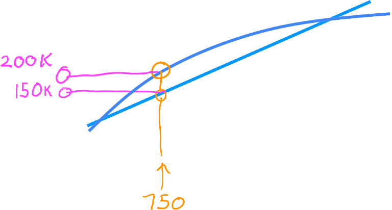

**Classification**

Classification predicts categories with a small number of possible outputs

- Email spam detection (spam/not spam) (binary classification)
- Face shape classification
- Breast cancer detection (benign, malignant type 2, malignant type 1)

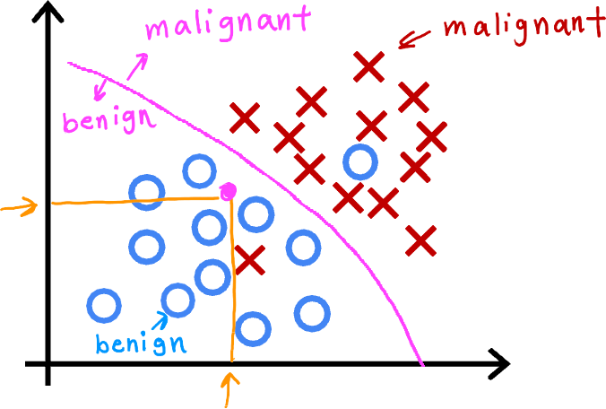

> You can try mixing both tasks, e.g. using the regression to solve classification problems, but the results will depend upon your specific task and they are usually performing badly.

## Unsupervised Learning

> Unsupervised learning Find something interesting in unlabeled data.

No specific answers to the problem, clustering the data into n groups.

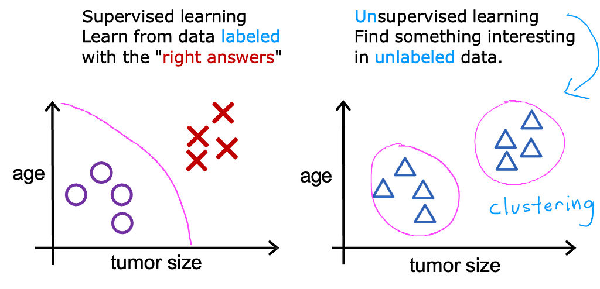

### Categories

- Clustering: Group similar data points together. E.g. KNN, K-mean
- Anomaly detection: Find unusual data points.
- Dimensionality reduction: Compress data using fewer numbers. E.g. PCA (Principal component analysis)

## Terminology of Machine Learning

**Dataset**

- Training set: Data used to train the model
- Validation set: Data used to valid the model (validate during the training)
- Testing set: Data used to test the model (test for the purpose data)

**Cost Function**

- Cost (Loss): Difference between Target and Prediction
- Cost Function: The method for distinguishing the Difference. E.g. MSE (Mean Square Error)

**Objective**

**Model**: selected method for solving the problem, sometimes called “Function”

**The procedure and terms of Machine Learning**

- Features (Input): x
- Prediction (Output): estimated *y or y-hat*
- Target (Supervised learning): y, so-called “Ground Truth”

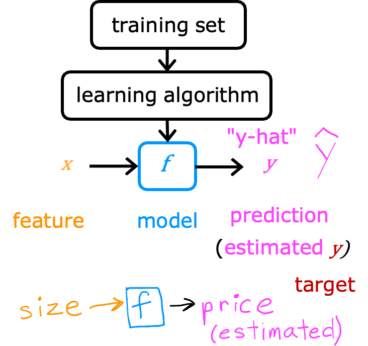

## Linear Regression

A basic Machine learning approach. It could be regression and classification, the difference is the output assumption.

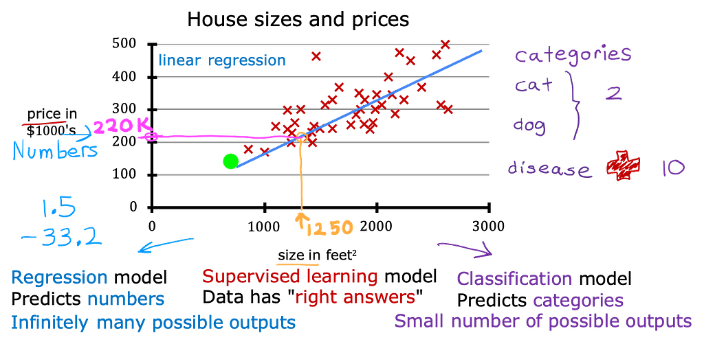

```
y = J(w, b)= w x + b
```

Simplified version

```
y = J(w)= w_1 x + w_0 1 = w x
```

### What do parameters (w, b) do?

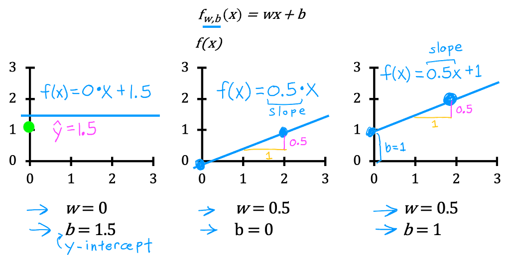

### Objective

Minimize the difference (cost) between the prediction (y-hat) and the answer (y)

```
Find w, b:
y^(i) is close to y^(i) for all (x^(i) , y^(i)).
```


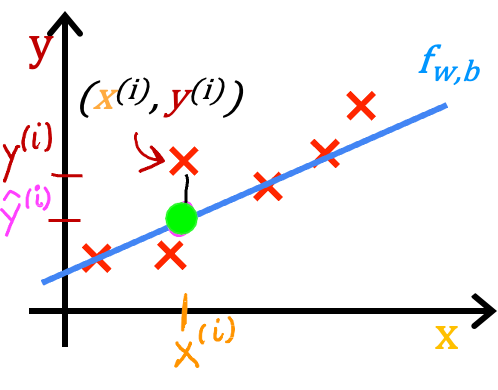

### Cost Function

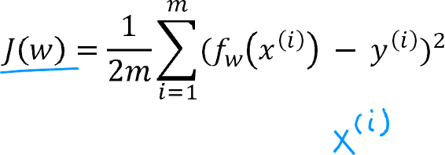

### What is the best function we can get?

The Objective is the minimum point of the curve. Approaching to the minimum by changing parameters (w).

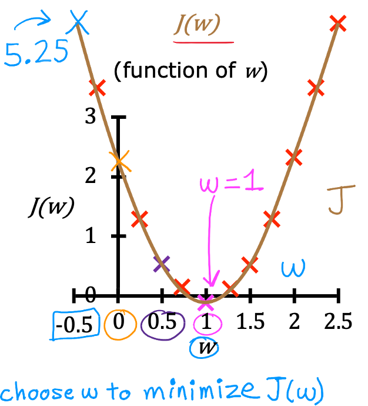

*fixed x with different w*

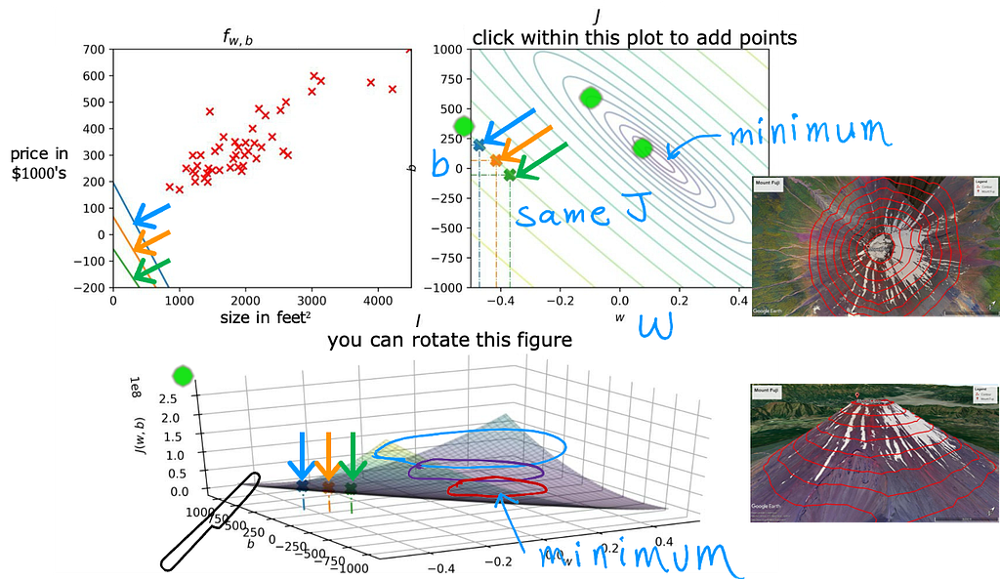

## Gradient Decent

The purpose is to minimize the cost. However, the problems usually have multiple minimums (local minima and global minima). So, we will try our best to find out the lowest value of the local minimum which is close to the global minimum.

> Gradient Descent is an optimization algorithm for finding a local minimum of a differentiable function. Gradient descent in machine learning is simply used to find the values of a function’s parameters (coefficients) that minimize a cost function as far as possible.

> Wikipedia

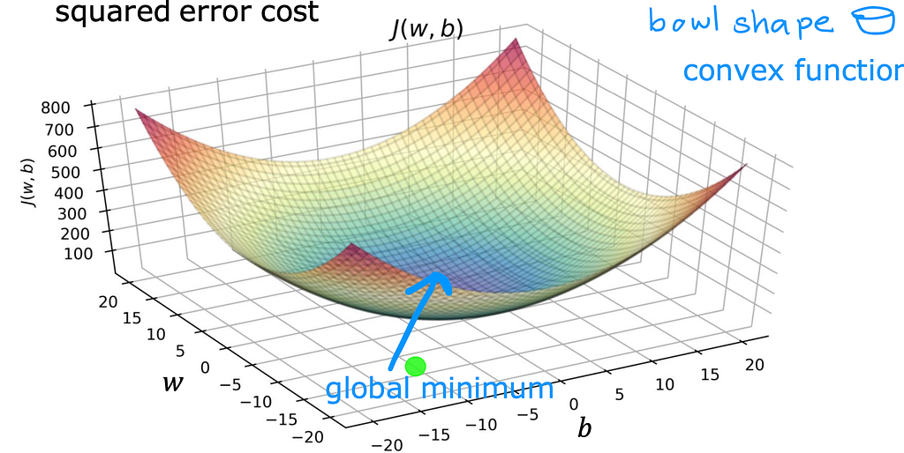

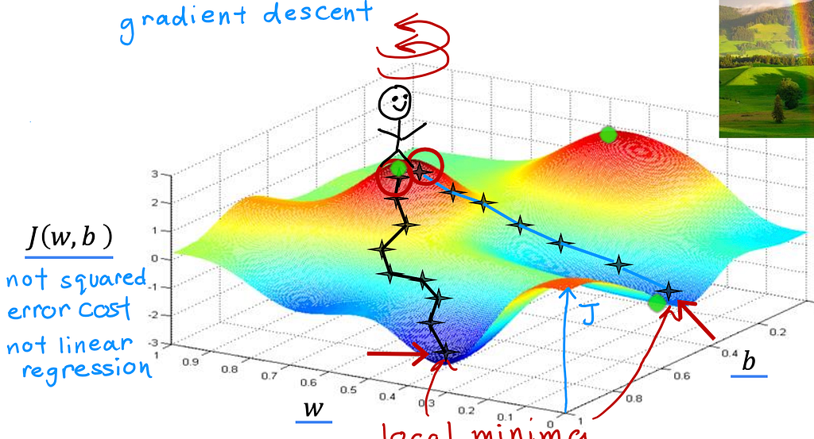

### Algorithm

repeat the process until convergence

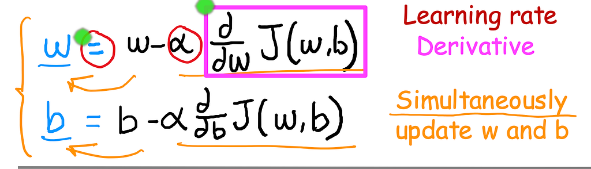

**learning rate** (alpha, or rho): , the step size of the optimization

Too Large

- Overshoot, never reach minimum
- Fail to converge, diverge

Too Small

- Gradient descent may be slow

Cost = 0

- The minimum points

**Derivative**: the “direction” of the optimization steps

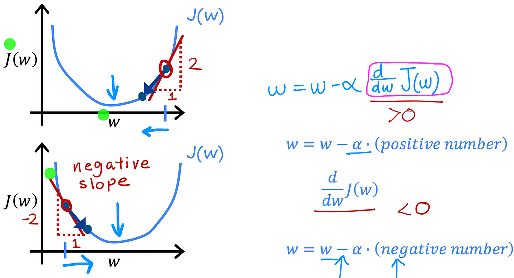

### Optimal Process of Gradient Descent

Near a local minimum,

- Derivative becomes smaller (By the nature of gradient descent)
- Update steps become smaller (By some specific optimization methods)

### Stochastic Gradient Descent (SGD)

> The insight of stochastic gradient descent is that the gradient is an expectation. The expectation may be approximately estimated using a small set of samples.

For a fixed model size, the cost per GD update depends on the training set size m, and requires a huge amount of computational cost for training the large dataset.

For SGD, it uses part of the data (Batch) for each step (iteration).

Batch and mini-batch

- Batch: Split the training set into n pieces
- minibatch stochastic methods: Split the training set into pieces with minibatch size (or batch size) as n.

## References

[Deep Learning](https://www.deeplearningbook.org/)

**Slides from Machine Learning Specialization** by **Andrew Ng**
