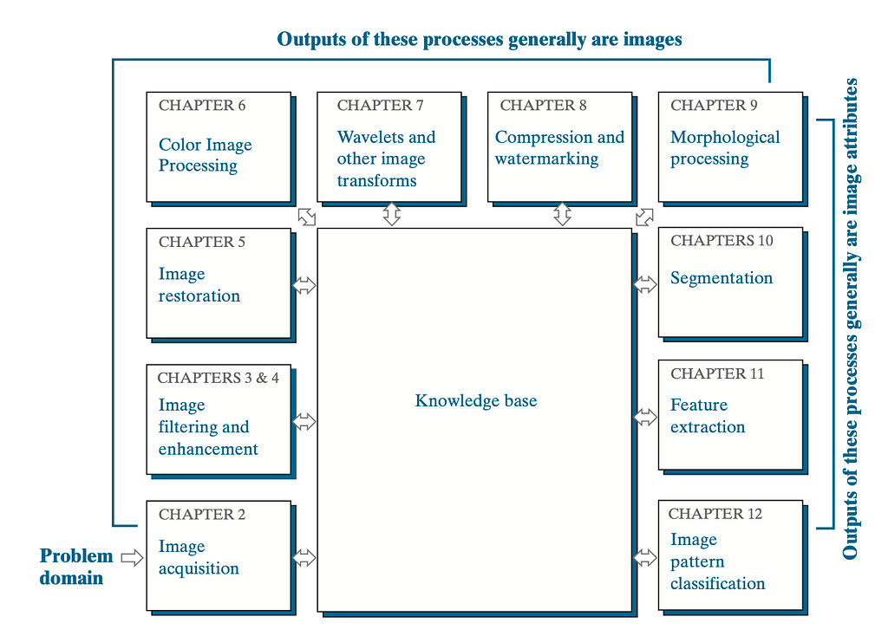
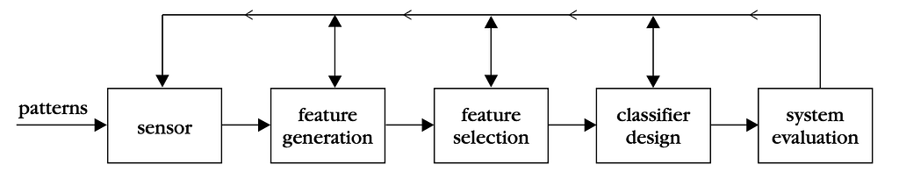
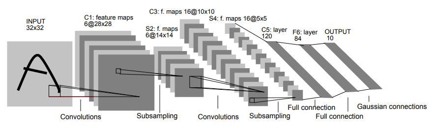
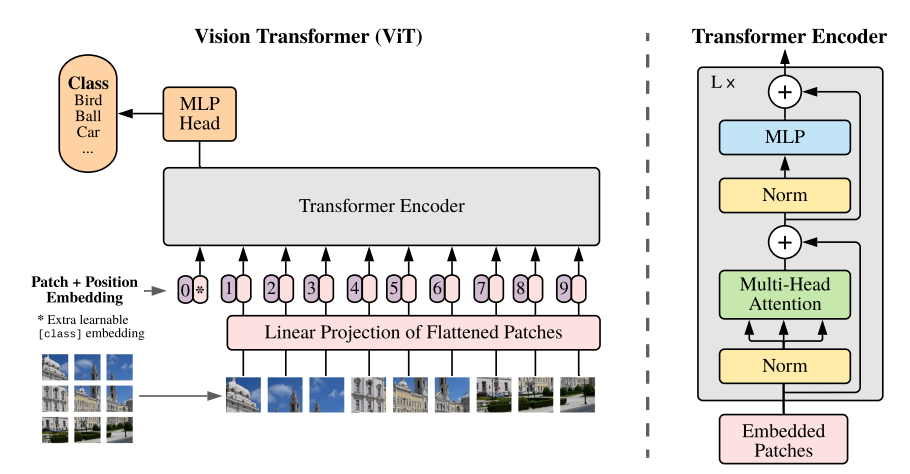

對影像處理的任務進行介紹  
Feb 17 2024

## 影像處理的任務介紹

數位影像處理(廣義)根據任務特性大致上可以分為三個階段（低階至高階）：Image Processing (狹義), Image Analysis, Computer Vision (Understanding)。

- Image Processing 影像處理(Low-Level Vision Task)：Input&Output 都是影像，屬於最底層的「步驟」或「方法」。例如：直方圖、傅立葉轉換等。
- Image Analysis影像分析：以先驗知識提取出影像的特定特徵（可以想像為Highlight特定特徵，輸出還是圖片），比如：人臉膚色的區域、X-ray image中血管的區域。
- Computer Vision (High-Level Vision Task): 用電腦模擬人類的視覺「感受」，與圖像的理解和圖形識別(Pattern Recognition)相關。例如：分類、判斷等。

事實上，在處理影像任務時，往往都會參考到各個不同的層面，三者在處理相對應任務時都多少會有共通項。因此並不算硬性的分類。

*From DIP課本*

### 深度學習的影像處理

深度學習中，大致上僅分為Low level and High level。而在兩者之中的Image Analysis 則根據處理的方式被歸為兩類之一。

## 影像處理任務導向的深度學習方法與實踐

### Pattern Recognition

圖形識別是一門「理解」的學問，而電腦視覺就是其中一個分支。大致上跟著以下步驟

1. 接收到圖形（輸入）: sensor
2. 生成並選擇需要的特徵: feature generation & selection
3. 對特徵進行分析和分類: classifier
4. 系統驗證（可理解為執行或輸出，後檢查）

*From PR 課本*

這種處理法是圖形識別的定式流程，把人類理解的流程以功能性進行區分。因此，在早期的作法上通常都是跟著Feature Extractor + Classifier進行。目前也常被使用，但在深度學習方法上大部分已經將兩者進行合併處理（功能區分還是可以這樣分，但實務上大部分並沒有辦法區分哪幾個模塊是特徵處理和分析的部分）。

### Convolution Neural Network (CNN) (1998~)

概念相似於影像處理中的Filtering，以卷積的方式進行（如果沒有加上非線性Activation function，就會是線性的）。這種處理法可以大幅減少計算所需的成本，相比於對每一個點做分析（所有特徵都連接至神經元），使用卷積核（ex: 3 by 3 kernal）進行整張圖像的特徵篩選。換言之，以卷積核取代大量的神經元（原始的神經網路設計，全聯接層Fully connected layer）。

CNN是目前相當常用的模塊，並有許多的變種及組合，是一個伴隨著讓深度學習是「深度」學習的歷史演進的推手之一。（證明使深度學習大幅擴展的模型主要模組，ImageNet競賽(ILSVRC) 的AlexNet (8 layers), Inception (22 layers), VGG (best: 16 layers, or 19 layers), ResNet (34, 50, 101, 1202)等）

以LeNet為例，該方式採取卷積作為特徵的擷取(C1~C5)，並加上全聯接層作為分類器(F6~output)，是很典型的圖形識別處理流程。

Y. Lecun, L. Bottou, Y. Bengio and P. Haffner, “Gradient-based learning applied to document recognition,” in Proceedings of the IEEE, vol. 86, no. 11, pp. 2278–2324, Nov. 1998, doi: 10.1109/5.726791.

### Vision Transformer (ViT) (2020~)

隨著Transformer在自然語言的發展，同時也引入影像的處理上。ViT以patch的方式將圖片分割+positional encoding作為Encoder的輸入，輸出則使用MLP Head (可以理解為pattern recognition的classifier)，僅使用Transformer 的Encoder（相似於BERT的處理方式）。ViT相比CNN有更強大的分析能力，但也更難收斂。目前的影像處理主流也以ViT為主。

流程大致上是：

1. 將圖片直接切分成特定數量的patch，並對他們的座標進行標記
2. 如Transformer encoder，以encoder依次處理所有的Patch
3. 將輸出以MLP Head進行分類或其他任務的處理（輸出以cls token作為輸出，或對整個token輸出進行平均）

[An Image is Worth 16x16 Words: Transformers for Image Recognition at Scale](https://arxiv.org/abs/2010.11929)

另外，現在也出現了DINO (電腦視覺的BERT)，一個千錘百鍊的Encoder，可以根據自己的任務加上MLP Head 或Decoder至特定應用端使用。

[Emerging Properties in Self-Supervised Vision Transformers](https://arxiv.org/abs/2104.14294)

## High-Level Vision Task

### **Object Classification**

對輸入的圖像進行類型的判別

### **Object Detection**

對輸入的圖像的內容進行類型、區域的判別。ROI (Region of Interest)在此的定義為該物體座標點及長寬（一個方形區域）。

### **Instance/**Semantic**Segmentation**

對輸入的圖像的內容進行類型、區域的判別。ROI (Region of Interest)在此的定義為該物體在圖片上的區域（每一個像素點都要區分）。

而Instance 和Semantic的區別則是區分類別的細緻程度。

- Semantic segmentation只需要分出像素點是屬於哪一類即可
- Instance segmentation則是各個物件都要被區分出，即使為同一類別。

ex: 圖片上兩個人重疊，Semantic segmentation只要知道這裡有人，Instance segmentation則可以分出兩個人都是人。

## Low-Level Vision Task

[Low-Level Vision Task-Image Restoration簡介](/zh-tw/blog/image-restoration-intro/)

### **Image Restoration**

影像的復原，又可以稱作「清晰化」的方法，其中包含了許多子分類：除霧（圖片霧霧的至清晰圖片）、超解析度成像（圖片小至大）等。

### Image Enhancement

影像的強化，使特徵變得比較明顯，相當類似於影像復原。例如：水中影像增強、低光度影像增強（使暗圖片物件細節清楚（類似某種程度的調亮），如果是變白天就是影像的轉譯）

### Image Alignment

把圖片對齊，可以應用在圖片的融合

### Image-to-Image Translation

把圖片從A特性轉成B特性。例如：白天變黑夜、春天變冬天。赫赫有名的Deep Fake也是這項領域的延伸應用。

## 延伸應用

### VQA (High-level)

給定圖片並提供對圖片內容相關問題的回答。結合圖片特徵的理解(Image feature extractor)和Image Captioning、NLP 的Question Answering (QA)

### Text-to-Image Generation (High-level)

將文字轉為圖片。例如：Dall-E等。

延伸影用則是最近相當知名的Text-to-Video Generation (OpenAI SORA)

[Sora: Creating video from text](https://openai.com/sora?video=tokyo-walk)

## Reference

Gonzalez, R. C., & Woods, R. E. (2019). Digital image processing (4th ed.). Publisher.

Sergios Theodoridis and Konstantinos Koutroumbas. 2008. Pattern Recognition, Fourth Edition (4th. ed.). Academic Press, Inc., USA.

[ViT（Vision Transformer）解析](https://zhuanlan.zhihu.com/p/445122996)
