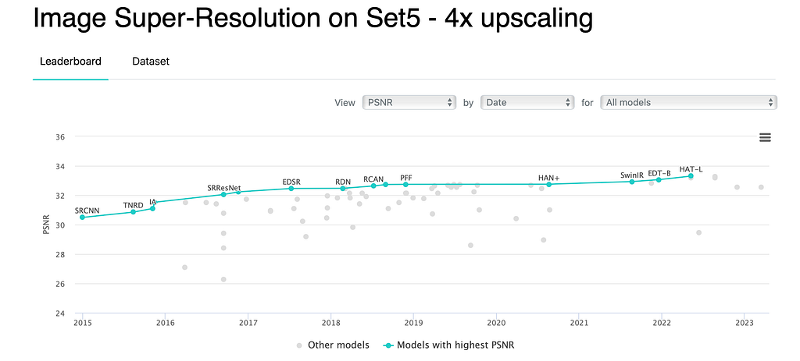
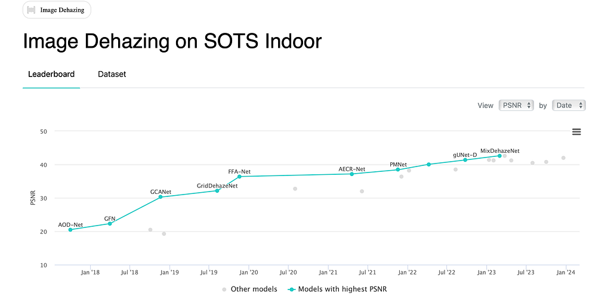
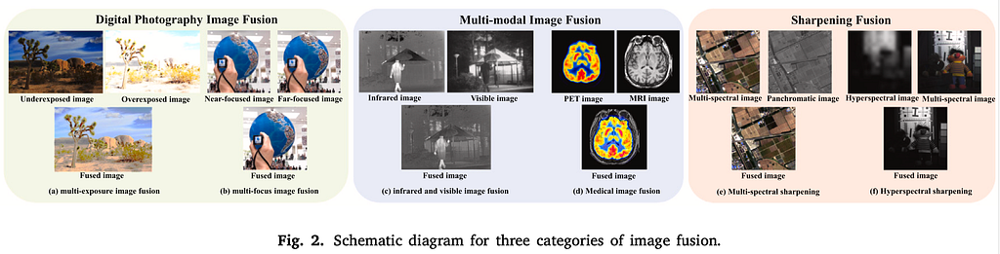

2023/11/28 統整自己對此的了解，著重於 Deep learning。  
2024/6/1 稍加補充  
剩餘內容待補充…

## What’s low-level vision task?

簡單而言，對於就是如何「感知」；而相對的，high-level則是「理解」。兩者的概念皆來自人類與外界的互動方式，「接觸」和「反應」都是不可或缺的。

而low-level vision中最容易聯想到的就是degradation task，目的是強化對於人類感官的「理解」。舉例：這個東西很「模糊」，代表感官對「東西」的判定並不靈敏，因此變「清晰」任務就是為此而生。

degradation task 的範圍很廣，我們可以從paper with code 上的分類略知一二, For example, Debluring, Super-Resolution, Inpainting, Color Calibration, Vision and Infared Fusion, etc.

## Image Restoration

如前面所述，image restoration就是解決degradation 的辦法。在Deep Learning興起前，我們必須仰賴相當充足的prior knowledge解決這些問題；在興起後，逐漸解決並超越人類的感官後，已經不須強求有強大理論基礎，而是強大的學習機制與特徵提取法才是未來的方向。

傳統的公式根據不同的scenario很多樣，但都是相似的：

> basic formula on textbook (DIP 4e)

g(x, y) = (h \* f )(x, y) + n(x, y)

> 處理除霧的Atmospheric Scattering Model (simplified)

I = J t + (1-t) A

> 除雨：

I = B + R

> Low-Light image enhancement: Retinex theory

S = R L

簡單而言，雖然不是很嚴謹，但本質上都可以使用同一種方式對問題進行「理解」，meaning that 他們都是屬於同一種問題！

## 幾個領域的介紹

### Super-Resolution超解析度(SR)

一個提升解析度（也可以說是圖片大小或縮放）的技術，從Low Resolution to High Resolution的近似。

傳統上以差值法interpolation為主，常見的包含nearest neighbor, biliear, bicubic。其中又以bicubic最為出名，至今仍是廣泛使用的演算法

深度學習的發展從2015左右開始SRCNN，一個使用了bicubic + 3 convolution layers 的網路，接著FSRCNN, SRGAN (SRResNet), EDSR, RCAN, …在約2018左右便已經超越人類感官，目前甚至對於「評判標準」的界定有更多的疑慮

處理方法：

1. 特殊的網路結構：關係到對問題的理解&NN的結構設計，也是各個方法不一樣的最大差異
2. 如何Upsample：同樣是input為LR, 輸出卻是SR (Same size as HR)，在解析度上升的同時「圖片大小」同時變大了，設計上大概會用下列三種做法

a. bicubic：SRCNN的做法，相當直觀的用傳統方式拉大圖片大小

b. deconvolution: 又稱為convolution transpose，倒過來的卷積，反過來提升解析度，但有機率出現”Checkerboard Artifact”，目前使用上較少（若針對超解析度的upsampling，實際上仍廣泛使用在各種神經網路中）

c. Sub-pixel layer: 又稱pixelshuffle，簡單而言就是透過拉大「通道」轉換為SR中的pixel，一部分的主流以此為主

### 除霧 Dehazing

簡單而言，就是去除霧氣，是Denoising, deblur的一種延伸。傳統上使用如上的公式，求出上式的某些參數、矩陣，進而套公式求解。其中最困難的就是如何想出這些關係。

資料庫

- RESIDE
- Kitti

傳統方法最具知名的就是何凱明的Dark Channel Prior

Deep learning分為兩種

1. 套公式，相當知名的有較前期的model, Dehazenet, AOD-Net等，用some techniques求出特別的參數等。AOD-Net近一步簡化大氣散射model
2. 超級模型，特別的結構，強大的學習能力。e.q. griddehazenet, FFA-Net，都是超強力的學習能力（換句話說是有很高的機會可適用於其他degradation任務上，例如MIRNet）

*http://paperswithcode.com*

### 除雪desnowing

除雪任務相似於除霧，去處下雪的影響。然而，除雪並不單單僅處理呈現為白點的「雪」的部分，也需要考慮朦朧霧氣的影響。因此，使其更加複雜。

資料庫

- Snow100k

幾個的深度學習方法

- desnownet

[https://ieeexplore.ieee.org/document/8291596/](https://ieeexplore.ieee.org/document/8291596/)

- JSTASR

[https://www.ecva.net/papers/eccv\_2020/papers\_ECCV/papers/123660749.pdf](https://www.ecva.net/papers/eccv_2020/papers_ECCV/papers/123660749.pdf)

### 除雨 Deraining

依照資料還可以分為streak & raindrop

### 低光度增強 Low-Light image enhancement

強化低光度影像細節與色調，使暗的部分看得清楚。訓練上則是對比暗影像及正常曝光的影像。

資料庫

- lol dataset
- Ve lol

方法

傳統方法以對比度調整(e.g. Histogram Equalization)和retinex (e.g. SSR, MSR, MSRCR), 大氣散射模型(比較少)等以公式假設為主。

深度學習則以retinex和特殊設計通用網路(general design)為主

- retinex: RetinexNet, KinD

[簡介Deep Learning Low-Light Image Enhancement (LLIE)](/zh-tw/blog/llie-intro/)

### Infrared And Visible/ Multi-exposure / Multi-Focus Image Fusion

把相同內容、不同特性的圖片群組合，將圖片賦予更多樣豐富的資訊。

Zhang, Hao, et al. “Image fusion meets deep learning: A survey and perspective.” *Information Fusion* 76 (2021): 323–336.

### Image Deblurring

### Image Inpainting

影像的修復。這項任務目的在修復「破損的影像」，例如：某些區塊的消失，相當接近於影像的生成。

前陣子相當知名的MAE也可被歸類於此

[https://openaccess.thecvf.com/content/CVPR2022/papers/He\_Masked\_Autoencoders\_Are\_Scalable\_Vision\_Learners\_CVPR\_2022\_paper.pdf](https://openaccess.thecvf.com/content/CVPR2022/papers/He_Masked_Autoencoders_Are_Scalable_Vision_Learners_CVPR_2022_paper.pdf)

### Image Matting

影像的去背，也可以視為分割的變種之一。傳統以三色圖（背景、前景、不確定區域）的定義實現。

近期則有靠著GAN取代三色圖以對比的方式達成去背和貼上

[https://openaccess.thecvf.com/content\_CVPR\_2020/papers/Sengupta\_Background\_Matting\_The\_World\_Is\_Your\_Green\_Screen\_CVPR\_2020\_paper.pdf](https://openaccess.thecvf.com/content_CVPR_2020/papers/Sengupta_Background_Matting_The_World_Is_Your_Green_Screen_CVPR_2020_paper.pdf)

## Extension

1. Medical Image Enhancement
2. Multimodal
3. Unsupervised
4. New architecture or techniques (ViT, Flow, GAN, Diffusion)
5. all in one image restoration: start from 2021 (it is one of the hottest topics in 2023)，結合多項任務於一個網路之中，以解決Practice that we don't have the prior info about the different weather conditions that may happen randomly or mix in a single timing.
6. low-level+high-level
7. Real-time and low-computation
8. underwater

### all-in-one image restoration

airnet

…

## Evaluation Metrics

### Reference

- PSNR
- SSIM
- LPIPS

### No-Reference

- NIQE
- PI
- IS/ FID

## Conclusion

由於任務簡單明瞭，現階段在SOTA的比拼上大部分都是靠特殊的結構取勝，也就代表大量的算力和複雜實驗設計，但可以觀察到這些任務在應用上都是相當實用且容易上手的，代表某些層面上可以看到在「應用面」或「任務的組合」上有更多的著墨空間。

另外，對我來說，這個領域相較於high-level task學習成本不高，入門階段學習時可以輕鬆的想像模型的架構和樣貌，進而接觸更進一步的內容。

## Reference

Digital Image Processing 4/e

some survey paper (待補上）

自己的實作經驗和調查

…
