簡單介紹LLIE  
2024/6/1 原理及文章大綱  
2024/6/5 補一些例子和連結

### 預備知識、任務屬性

- [深度學習的數位影像處理介紹](/zh-tw/blog/dl-image-processing-intro/)
- [Low-Level Vision Task-Image Restoration簡介](/zh-tw/blog/image-restoration-intro/)

## 目的

把圖片從Dark to Bright(Normal Exposure)，強化圖片「前景」內的細節。有別於Image 2 Image translation，並不是轉換圖片的屬性，而是把被Dark破壞的圖片細節及色調還原。因此，可以將此任務簡單的分為兩個難點：**色調強化、細節還原**。

在深度學習LLIE，由於細節還原本身就是深度學習網路的標的本身，因此在設計上不見得會針對此點再深入探討，而將重點放在其圖片及學習性質上，也就是**色調強化（圖片的某些特性）、細節還原（學習機制）**，而不會有特別的細節還原。

## Outline

1. Non-DL LLIE & LLIE characteristic
2. DL LLIE
3. Evaluation
4. Benchmark Datasets
5. Reference

## 1. Non-DL LLIE & LLIE characteristic

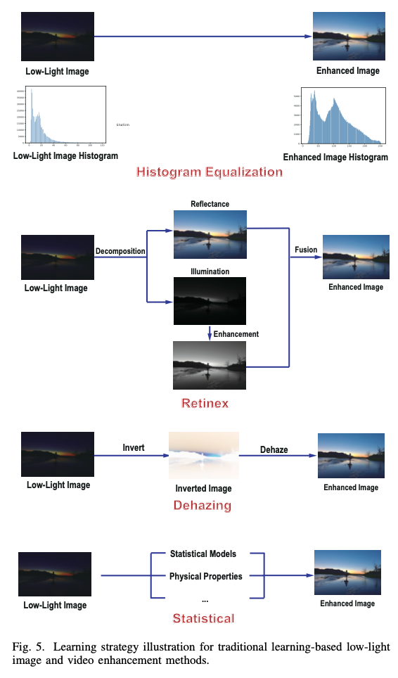

*From Low-Light Image and Video Enhancement: A Comprehensive Survey and Beyond*

基本上可以分為兩大流派：Histogram Equalization 和 Retinex (以理論為基礎，其中也可包含Dehazing)，並配合Statistical方法延伸

### 1–1. 低光度影像在色彩空間上的特性

在影像處理中，有不少特型可以直接連結到低光度等曝光不足的圖片，特別是「色彩空間」

有許多color space representation都特別把「曝光」這項特性納入考量，又可稱作 “Illumination”, “Brightness”, “Lightness” and “Lumination”. 例如：HSV, HSI, YUV (YCbCr), LAB

首先，假設原始取得的影像為RGB三通道影像

HSV中Value代表三通道最大值（又稱亮通道，與除霧中暗通道對比）

```
V = max(R, G, B)
```

HSI中Intensity則是三通道的平均

```
I = mean(R, G, B)
```

YUV中Y則代表Luminance

```
Y =  0.257 * R + 0.504 * G + 0.098 * B
```

換而言之，既然能拆解，那對此分量單獨增強便是一種解決方式

### 1–2. Histogram Equalization

在數位影像處理中，最基本和最先學習的影像處理法直方圖等化。而對彩色影像，通常會轉換至特定色彩空間以直方圖增強特定分量後再還原至原始空間（E.g. RGB to LAB (L represents Luminance) to RGB）

E.g. CLAHE

### 1–3. Retinex

Retinex源自[**Land的論文**](https://www.cnbc.cmu.edu/~tai/cp_papers/E.Land_Retinex_Theory_ScientifcAmerican.pdf)，描述接收到的視覺可以用以下公式簡略概述：

```
I = L R
# I 是接收到的訊息
# L 是 Luminance
# R 是 Reflectance, 反射分量，代表物體本身
```

以文字敘述，就是「接收到的影像是由亮度的分量和物體本身的反射決定」，反射分量被假設為恆久不變並不受環境影響；而亮度分量則代表著環境本身，亦即空間的變化（亮度）。

雖然是一個比較簡易的模型，但也足夠對任務進行假設。那麼在影像增強上，任務就變成想盡辦法「取得R」  
(SSR 取原始圖片和設計出的L取log相減, 由於是對彩色影像，L 通常簡化以模糊後的影像取代；MSR則是取三個預設的尺度計算後融合)

E.g. SSR, MSR, MSRCR, MSRCP

### 1–4. Other Theorem and Retinex

當然，並不是只有Retinex的理論可以描述接收影像的過程，其中最常使用的就是大氣散射模型 (Atmospheric Scattering Model, ATSM)。

```
I = t J + (1 - t) A
```

ATSM被廣泛用於除霧的影像復原（當然理論上適用於所有影像復原任務），但除霧的ATSM卻不能直接應用在LLIE，因為圖片特性仍具壹定的相異性。

故此，Dong’14發現反轉後的低光度影像可以適用於大氣散射模型的假設。因此將改寫，順利以此解決低光度問題

```
I from ATSM = (1 - I from Retinex)
J from ATSM = (1 - R from Retinex)
```

以另一個角度而言（結果論），普遍除霧任務假設暗通道可代表無霧區域，而低光度受到「暗」的影響，暗通道會涵蓋大量的被破壞區域，注重的則會是亮通道（或稱作被影響相對比較少的區域）

另外，在LIME中對兩者公式進行深入探討，可以發現兩者實質上是相同的假設，但Retinex較為簡化

最具盛名的方法就是LIME，結合最佳化及Retinex理論進行影像增強

[https://ieeexplore.ieee.org/document/7782813](https://ieeexplore.ieee.org/document/7782813)

## 2. DL LLIE

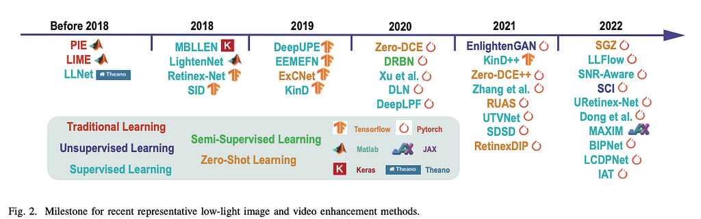

*Low-Light Image and Video Enhancement: A Comprehensive Survey and Beyond*

深度學習本身就是一種相當複雜的最佳化過程，更因其Black Box特性，更簡化設計上的假設和增強的做法。

普遍上可以用簡單的分類法分為兩類，以理論為基礎（通常是Retinex）和非以理論假設（強學習能力的模型）。當然，更多的發展基本上都是兩者交織，**不完全可以用二元的方式進行分類**。

### 2–1. 基於理論假設的方法

RetinexNet (2018)的假設有別於「取得R」，而是假設「輸入及輸出都有個別的R&L」，換而言之，代表其增強過程可以被敘述為：分解出R&L, 強化L to L hat, 融合R & L hat。這種做法也是現今主流之一，例如[KinD](https://github.com/zhangyhuaee/KinD) (2019), Retinexformer、URetinex-Net等。（大家取名時Retinex大多都會出現在名字）

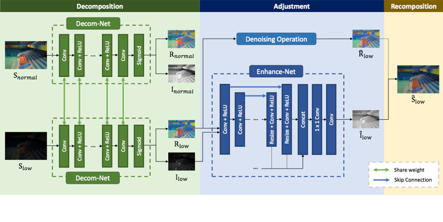

*RetinexNet*

[BMVC2018 Deep Retinex Decomposition](https://daooshee.github.io/BMVC2018website/)

前面也有提及**色調強化、細節還原**兩項任務的困難點。在早期的深度學習方法下，亦有被考慮至其設計（雖然兩者本來就都是最佳化的標的）。下圖方法先處理去噪再針對對比度調整。對比度調整的部分採取ATSM的增強法進行。

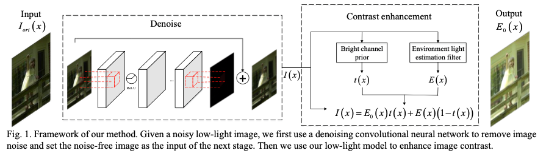

*DOI: 10.1109/ICIP .2017.8296876*

另外，我的研究成果是使用大氣散射模型的假設（目前比較少見使用ATSM非單純Retinex）為基礎建構，並配合全域局部的影像處理方法影像增強。另外，也觀察到深度學習下不同功能性模組學習到的特徵（相似於比較深度學習剛導入時對各層的探討），可以觀察到深度學習在某種程度仍是受自然的特性引導的現象，而非完全的不可理解黑箱。

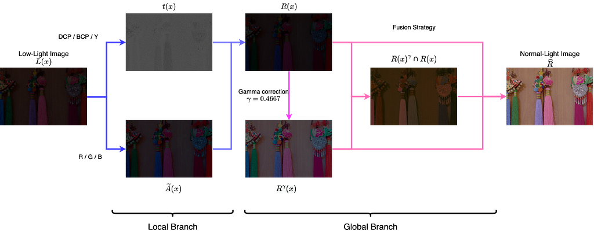

- [GitHub - Shyandram/CPGA-Net-Pytorch](https://github.com/Shyandram/CPGA-Net-Pytorch.git)
- [GitHub - Shyandram/CPGA-Net\_Plus: This is the implementation of CPGA-Net+ based on Pytorch.](https://github.com/Shyandram/CPGA-Net_Plus)

### 2–2.非基於理論假設的方法

現今的model則隨著深度和學習機制的深入研究而有相當多樣的方法。

EnlightenGAN (2021)，以GAN (生成對抗網路)…

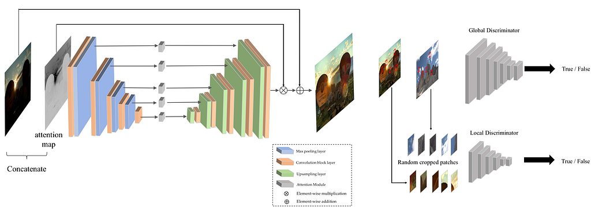

[GitHub - VITA-Group/EnlightenGAN: \[IEEE TIP\] "EnlightenGAN: Deep Light Enhancement without Paired Supervision" by Yifan Jiang, Xinyu Gong, Ding Liu, Yu Cheng, Chen Fang, Xiaohui Shen, Jianchao Yang, Pan Zhou, Zhangyang Wang](https://github.com/VITA-Group/EnlightenGAN)

LLFlow (2022)以normalizing flow為基礎，以反向的方式學習照明場景的多樣性質，並將其映射至高斯分佈中。其概念也有以理論的先驗特徵引導學習，Encoder中以直方圖等化、Color map (Retinex中的R)、Noise map (前面所提**細節還原**處理的雜訊)

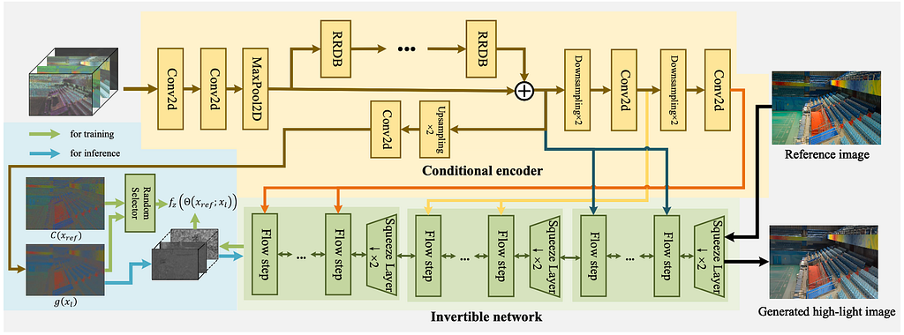

*LLFlow*

[GitHub - wyf0912/LLFlow: \[AAAI 2022\] The code release of paper "AAAI Low-Light Image Enhancement with Normalizing Flow"](https://github.com/wyf0912/LLFlow)

MIRNet(2020)以尺度、解析度和連接機制組合，將空間的特征以不同的截取方式組合，達到優異的效果。

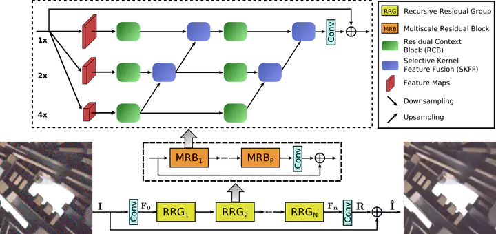

*MIRNet*

[GitHub - swz30/MIRNet: \[ECCV 2020\] Learning Enriched Features for Real Image Restoration and Enhancement. SOTA results for image denoising, super-resolution, and image enhancement.](https://github.com/swz30/MIRNet)

（後續待補充）

### 2–3. Unsupervised LLIE（待補充）

Zero-DCE (2020)

利用迭代多次Light-Enhancement Curve的方式，預測不同階段的參數Alpha，以校正的方式做影像增強。

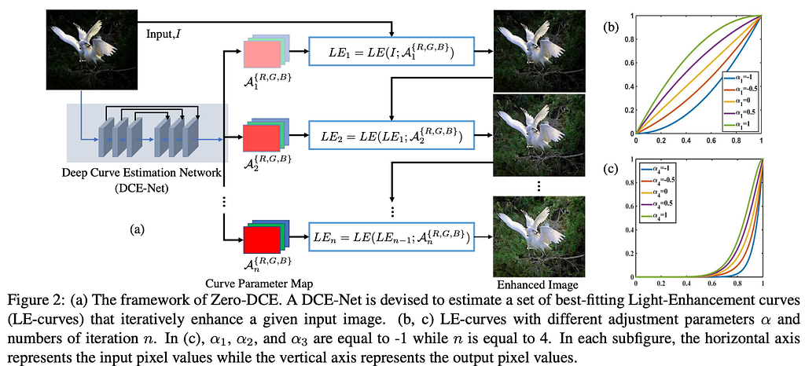

[GitHub - Li-Chongyi/Zero-DCE: Zero-DCE code and model](https://github.com/Li-Chongyi/Zero-DCE)

SCI (2022)

亦使用迭代的方式，以F作為亮度預測及Self-Calibrate加強使訓練時各階段收斂到相同狀態。實際使用僅需一次F的計算。

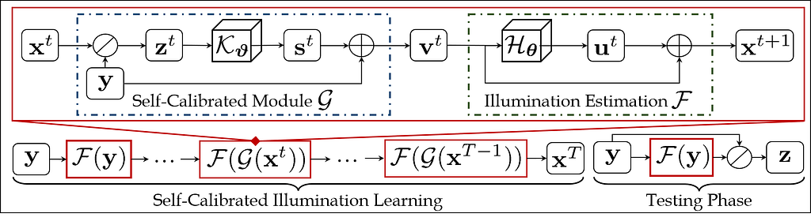

[GitHub - vis-opt-group/SCI: \[CVPR 2022\] This is the official code for the paper "Toward Fast, Flexible, and Robust Low-Light Image Enhancement".](https://github.com/vis-opt-group/SCI)

## 3. Evaluation

### 3–1. Image quality assessment

PSNR, SSIM, LPIPS

NIQE BRISQUE

### 3–2. High-level task

Object Detection, Instance Segmentation

## 4. Benchmark Dataset

### 4–1. Low-Level Vision Task (without paired data)

- LIME/MEF/VV/DICM…

[BMVC2018 Deep Retinex Decomposition](https://daooshee.github.io/BMVC2018website/)

### 4–2. Low-Level Vision Task (with paired data)

- LOL dataset (v1)

[BMVC2018 Deep Retinex Decomposition](https://daooshee.github.io/BMVC2018website/)

- LOL dataset (v2)

[GitHub - flyywh/CVPR-2020-Semi-Low-Light](https://github.com/flyywh/CVPR-2020-Semi-Low-Light)

- VE-LOL

[Benchmarking Low-Light Image Enhancement and Beyond](https://flyywh.github.io/IJCV2021LowLight_VELOL/)

- MIT-Adobe 5K

[MIT-Adobe FiveK dataset](https://data.csail.mit.edu/graphics/fivek/)

- SICE

以另一個任務MEF (Multi-exposure image fusion)中underexposure作為數據的驗證庫。

[GitHub - csjcai/SICE: Learning a Deep Single Image Contrast Enhancer from Multi-Exposure Images (TIP 2018)](https://github.com/csjcai/SICE)

- SID

[GitHub - dvlab-research/SNR-Aware-Low-Light-Enhance: This is the official implementation for the paper "SNR-aware low-light image enhancement" in CVPR2022](https://github.com/dvlab-research/SNR-Aware-Low-Light-Enhance)

### 4–3. High-level Vision Task

- ExDark

高階任務（物件偵測）的驗證

[GitHub - cs-chan/Exclusively-Dark-Image-Dataset: Exclusively Dark (ExDARK) dataset which to the best of our knowledge, is the largest collection of low-light images taken in very low-light environments to twilight (i.e 10 different conditions) to-date with image class and object level annotations.](https://github.com/cs-chan/Exclusively-Dark-Image-Dataset)

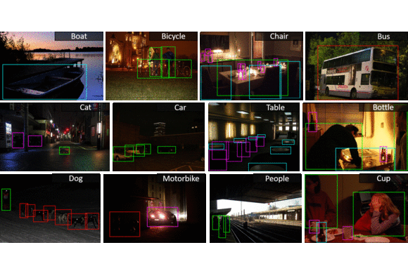

- Dark Face

[DARK FACE: Face Detection in Low Light Condition](https://flyywh.github.io/CVPRW2019LowLight/)

## Reference

**待補充完善**

Low-Light Image and Video Enhancement: A Comprehensive Survey and Beyond

[Low-Light Image and Video Enhancement: A Comprehensive Survey and Beyond](https://arxiv.org/abs/2212.10772)

Low-Light Image and Video Enhancement Using Deep Learning: A Survey (Github有簡中版可供參考)

[Low-Light Image and Video Enhancement Using Deep Learning: A Survey](https://arxiv.org/abs/2104.10729)

自己的文獻探討和經驗
