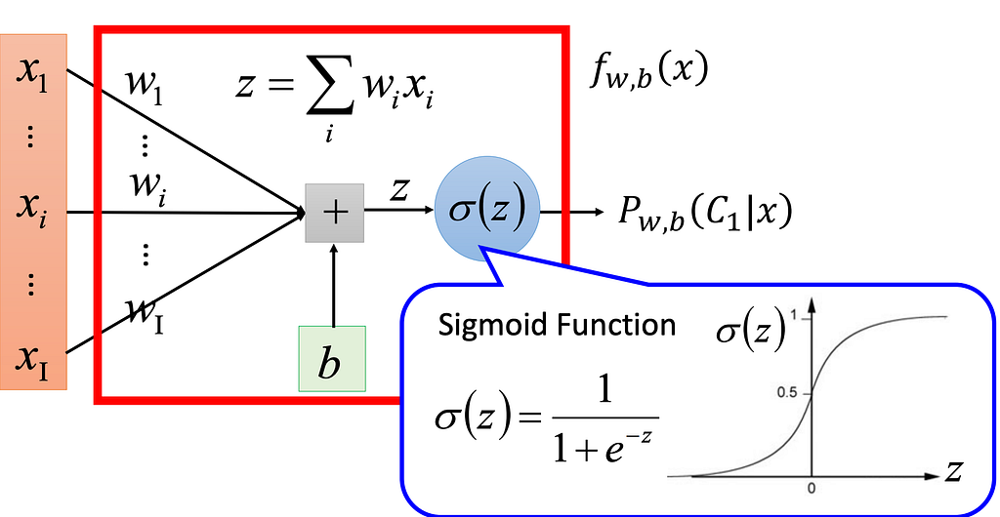
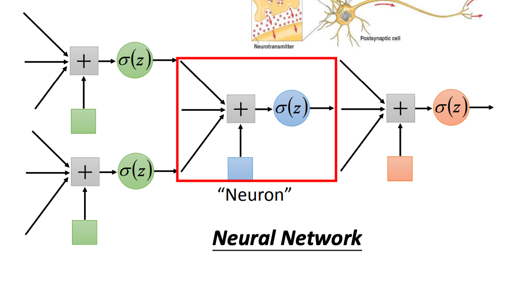
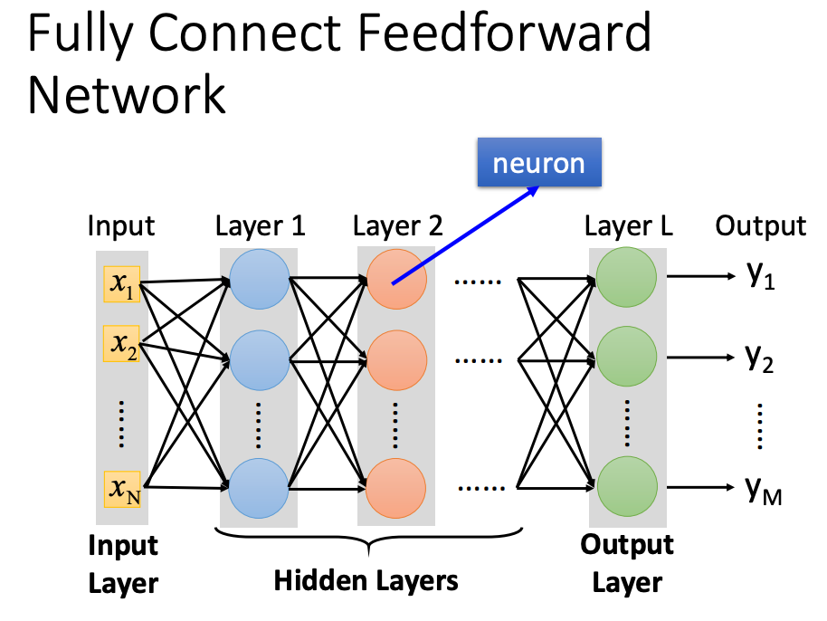
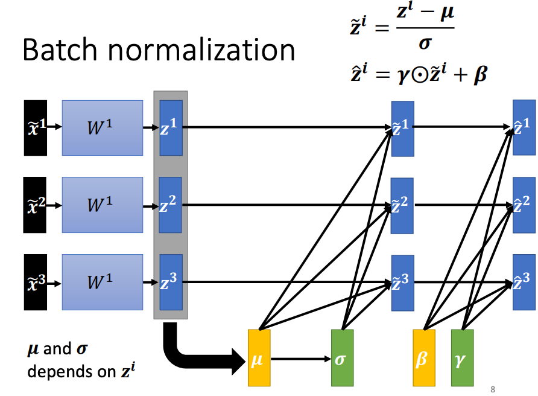
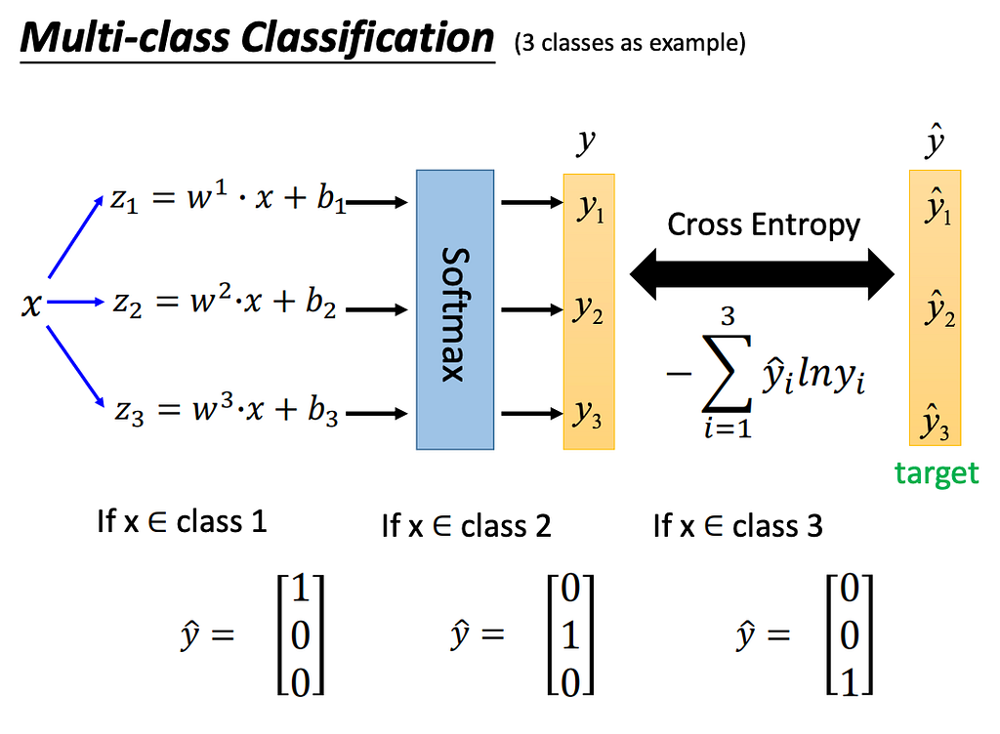
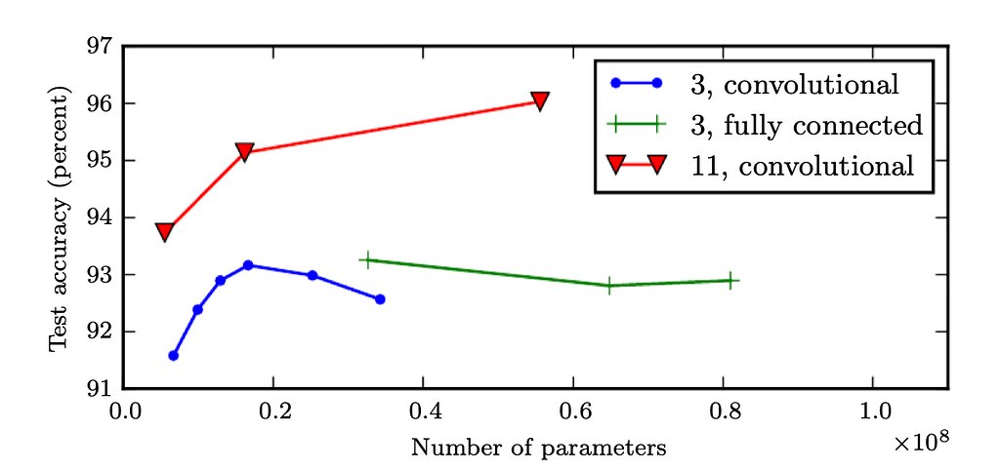
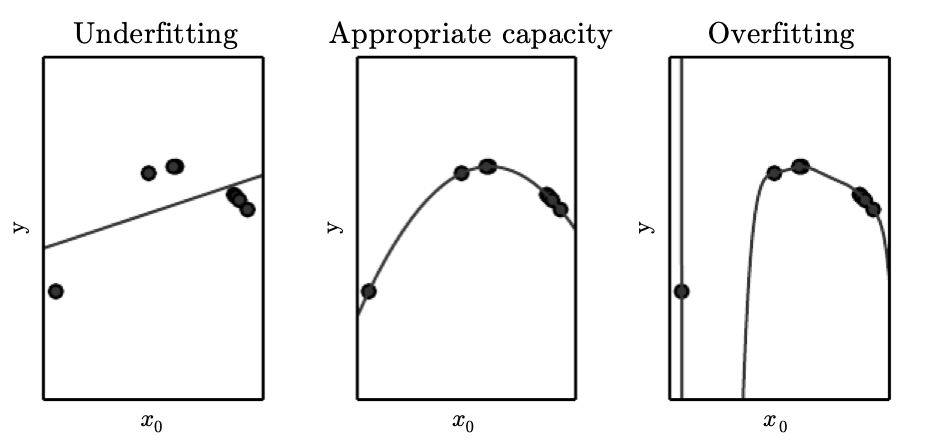
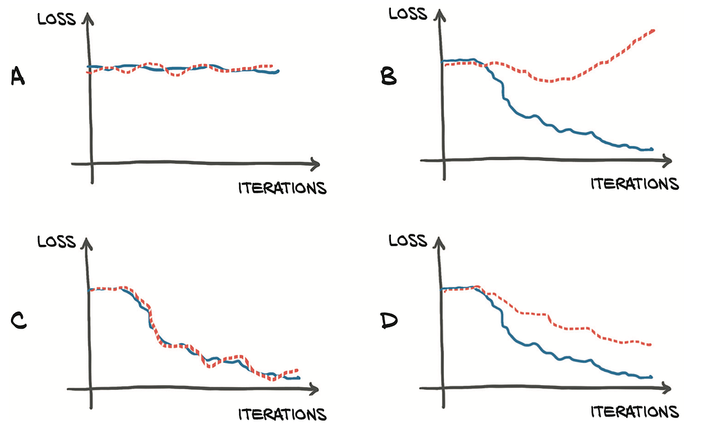
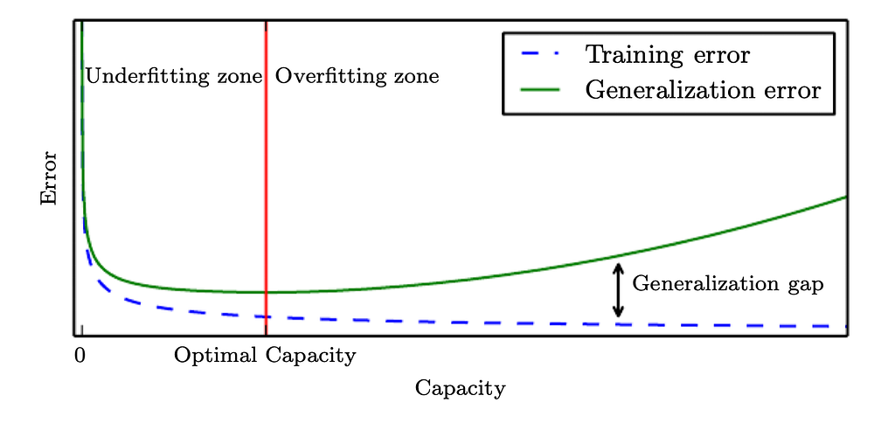

> **2026 年 10 月更新：** 原文保持不動，幾處不夠精確的說法（感知器與 logistic regression、sigmoid 的用途、batch size「越大越好」等）以「更正」標註。另外補充了近年 Transformer／大型語言模型中的主流元件：GELU／SwiGLU、LayerNorm／RMSNorm、殘差連接，以及 AdamW、Lion、Muon 等優化器。

## 機器學習及類神經網路學習筆記

快速上手基本的觀念  
Feb 1, 2024

## Artificial Neural Network 類神經網路

### Perceptron

又稱為logistic regression，發想自神經元的運作。由線性回歸和activation function組成

> **更正：** 原文提到感知器「又稱為logistic regression」，更精確的說法是：兩者都是 $z = \mathbf{w}^\top\mathbf{x} + b$ 再接一個函數，但經典感知器用 step function $\hat{y} = \mathbf{1}[z > 0]$ 輸出 0/1，並以感知器學習規則（分類錯誤才更新）訓練；logistic regression 用 sigmoid $\sigma(z) = \frac{1}{1+e^{-z}}$ 輸出機率，並以 cross-entropy（最大概似）訓練。兩者結構相近，但不是同一個方法。

### MultiLayer Perceptron (MLP)

疊加複數個logistic regression形成

### Deep Neural Network (DNN)

MLP持續疊加，即為深度學習的神經網路，通常定義為三層以上稱為Deep Neural Network

> **更正：** 原文提到「通常定義為三層以上」，更精確的說法是：深度沒有統一門檻，常見說法是隱藏層超過一層即可稱為 deep，而「三層」指總層數或隱藏層數，各教材不一。

### Activation Function

注意：若在perceptron or MLP各個節點沒有使用nonlinear activation function，函式仍為線性

1. Softmax
2. Sigmoid
3. ReLU
4. Leaky ReLU

#### 近年主流的激活函數（2026 補充）

- **GELU**（Hendrycks & Gimpel, 2016）：$\mathrm{GELU}(x) = x\,\Phi(x)$，$\Phi$ 為標準常態分布的 CDF，依輸入大小平滑加權，而非像 ReLU 依正負號硬切。
- **SiLU / Swish**（Elfwing et al., 2017；Ramachandran et al., 2017）：$\mathrm{Swish}(x) = x\,\sigma(\beta x)$，$\beta = 1$ 時即 SiLU。
- **SwiGLU**（Shazeer, 2020）：用在 Transformer 的 feed-forward 層，$\mathrm{FFN}(\mathbf{x}) = \big(\mathrm{Swish}(\mathbf{x}W) \odot \mathbf{x}V\big)W_2$，效果優於 ReLU、GELU 版本；LLaMA 等大型語言模型以它取代 ReLU，已是 LLM 的常見預設。

另外，Softmax 作用在整個向量上，通常只用在分類的輸出層，而非隱藏層。

### Normalization

#### BatchNorm、LayerNorm 與 RMSNorm（2026 補充）

標準化後再做可學習的縮放與平移：$y = \gamma \frac{x - \mu}{\sqrt{\sigma^2 + \epsilon}} + \beta$，差別在統計量沿哪個維度計算：

- **BatchNorm**（Ioffe & Szegedy, 2015）：沿 mini-batch 計算，CNN 常用；訓練與推論行為不同，batch 太小時效果變差。
- **LayerNorm**（Ba et al., 2016）：對單一樣本的所有特徵計算，與 batch size 無關，成為 Transformer 的標準配置。
- **RMSNorm**（Zhang & Sennrich, 2019）：省略減平均，只除以均方根 $\sqrt{\frac{1}{n}\sum_i x_i^2 + \epsilon}$，效果相當但更快，LLaMA 採用它並放在每個子層的輸入端（pre-normalization）。

### Design of Output Layer

根據目的採取不同的輸出層模式

- **普通的output**

接上特定的activation Function，把數值鎖在固定區間，根據目的變化。

E.g. Sigmoid為\[0,1\], 適合用於回歸問題上

> **更正：** 原文提到「Sigmoid為[0,1]，適合用於回歸問題上」，更精確的說法是：sigmoid 值域為 $(0,1)$，主要用於二元（或多標籤）分類輸出機率；一般回歸的輸出層不接激活函數（linear output），只有目標值本身落在 0 到 1 之間時才會用 sigmoid。

- **Softmax layer**

### Deep Learning

越深(depth)越寬(width)學習能力越強，1990年代發展以深度(width)為主（如SVM），2000年後以深度(depth)為主並有突破性的發展。

> **更正：** 原文提到「1990年代發展以深度(width)為主（如SVM）」，更精確的說法是：此處應為「寬度」，且 SVM 是 kernel method，並非寬的類神經網路，1990 年代是以 SVM 等淺層方法為主流。

> **更新（2026）：** 單純疊深並不一定更好，ResNet（He et al., 2015）以殘差連接 $\mathbf{y} = F(\mathbf{x}) + \mathbf{x}$ 才讓上百層網路能順利訓練。2017 年的 Transformer（Vaswani et al.）結合 attention、MLP、殘差連接與 LayerNorm，此後成為 NLP 乃至影像、語音的主流架構，也是大型語言模型的基礎。

## Training

### Backpropagation (Gradient Decent)

Chain Rule,…

[Introduction to Machine Learning](/en/blog/introduction-to-machine-learning/)

### Optimization

皆為基於SGD的優化方法

SGD, SGD with momentum, RMSprop, Adam, …

> **更新（2026）：** 目前訓練 Transformer／LLM 最常見的是 **AdamW**（Loshchilov & Hutter, ICLR 2019），把 weight decay 從 Adam 的自適應更新中解耦。較新的選擇有 **Lion**（Chen et al., 2023，只追蹤 momentum、以 sign 更新，較省記憶體）與 **Muon**（Keller Jordan, 2024，以 Newton–Schulz 迭代將隱藏層 2D 權重的 momentum 更新近似正交化，其餘參數仍用 AdamW）；Liu et al.（2025）報告 Muon 在大型模型上約有 AdamW 2 倍的計算效率。

### Mini-Batch (或簡稱Batch)

如何選擇minibatch的大小(batch size)攸關收斂性，理論上越大越好

太小

- 訓練時間拉長、mini-batch差異大，導致梯度震盪大、不容易收斂

太大

mini-batch差異極小，容易停在local minimum

> **更正：** 原文提到 batch size「理論上越大越好」，更精確的說法是：大 batch 梯度估計較穩定、平行效率較高，但並非越大越好。Keskar et al.（2016）發現大 batch 傾向收斂到 sharp minima、泛化較差，小 batch 的梯度雜訊反而有助於找到 flat minima。

### Iteration and Epoch

迭代次數

### Loss Function 損失函數

Classification: Cross entropy loss

Regression: MSE (L2 Loss), MAE(L1 Loss)

### Evaluation of Loss Curve

四種狀況，觀察其變化趨勢

- A: loss都不變

1. 若loss數值高，代表幾乎不具收斂性。數據集or模型需要替換
2. 若loss數值低，代表已經收斂，可能問題過於簡單或iteration間隔過大(一個batch的資料太多)，無法顯示其趨勢

- B: Overfitting

Early stopping，在minimum loss時結束訓練

- C: fitting或 underfitting。

1. 若已經達到optimal的狀態可結束訓練，通常是訓練集和驗證集高度相似才會發生
2. 若是underfitting，可增加iteration使其接近收斂情形。

- D: 驗證數值高於訓練數值，穩定下降。

常見情況，停止在lowest validation loss

*From textbook Deep Learning with Pytorch*

### Capacity, Underfitting, Overfitting

**Capacity**

模型的能力誤差曲線也相似於訓練曲線

**Underfitting**

1. Check your code (bug or input/target)
2. Make model bigger (if high testing error, for the guarantee of convergence) or smaller (if low testing error, for faster convergence)
3. select better optimization way(Optimizer, Learning Rate)

> **更正：** 原文第 2 點提到 underfitting 時可把模型變小，更精確的說法是：underfitting 指訓練誤差就很高，應加大模型或改善訓練；縮小模型不能解決 underfitting，只是效率考量。

**Overfitting (Low Training Error but High Testing Error)**

1. Early Stopping
2. Check your dataset (Divergence between the Training set and validation set (or testing set))

### Vanishing and Exploding gradient problem

- Gradient Vanishing

深度學習網路常見的問題，由於深度過深，不斷地反向傳播，梯度隨著深度增加越變越小（指數級別變小，幾乎消失）。

- Gradient Exploding

深度學習網路、初始權重數值過大，發現權重數值變極大，輸出數值變成NaN or Inf。

### **補救方法**

- Activation Function (ReLU),
- Normalization (Gradient Normalization, Batch Normalization),
- Residual Connection
- Weight Initialization
- Fine Tuning
- Reducing the model size

> **更新（2026）：** 梯度爆炸最常用的是 **gradient clipping**（限制梯度 norm）；而 Residual Connection 與 LayerNorm／RMSNorm 是現代深層網路能穩定訓練的關鍵。"Fine Tuning" 與 "Reducing the model size" 較像降低訓練難度的策略，並非直接解決梯度問題。

### 如何加強模型效能

- data augmentation
- more training data
- Stronger Model (Deeper, better structure for better convergence)
- better training strategy (optimizer, …)

## References

- [Deep Learning](https://www.deeplearningbook.org/)
- [Deep Learning with PyTorch - Eli Stevens, Luca Antiga, and Thomas Viehmann](https://www.manning.com/books/deep-learning-with-pytorch)
- [ML 2021 Spring](https://speech.ee.ntu.edu.tw/~hylee/ml/2021-spring.php)
- [浅析深度学习中Batch Size大小对训练过程的影响](https://zhuanlan.zhihu.com/p/83626029)

## 延伸閱讀（2024–2026）

- [GELU — Hendrycks & Gimpel, 2016](https://arxiv.org/abs/1606.08415)
- [SiLU — Elfwing, Uchibe & Doya, 2017](https://arxiv.org/abs/1702.03118)
- [Searching for Activation Functions（Swish）— Ramachandran et al., 2017](https://arxiv.org/abs/1710.05941)
- [GLU Variants Improve Transformer（SwiGLU）— Shazeer, 2020](https://arxiv.org/abs/2002.05202)
- [Batch Normalization — Ioffe & Szegedy, 2015](https://arxiv.org/abs/1502.03167)
- [Layer Normalization — Ba, Kiros & Hinton, 2016](https://arxiv.org/abs/1607.06450)
- [RMSNorm — Zhang & Sennrich, 2019](https://arxiv.org/abs/1910.07467)
- [Deep Residual Learning（ResNet）— He et al., 2015](https://arxiv.org/abs/1512.03385)
- [Attention Is All You Need — Vaswani et al., 2017](https://arxiv.org/abs/1706.03762)
- [LLaMA — Touvron et al., 2023](https://arxiv.org/abs/2302.13971)
- [AdamW — Loshchilov & Hutter, 2017/2019](https://arxiv.org/abs/1711.05101)
- [Lion — Chen et al., 2023](https://arxiv.org/abs/2302.06675)
- [Muon — Keller Jordan, 2024](https://kellerjordan.github.io/posts/muon/)
- [Muon is Scalable for LLM Training — Liu et al., 2025](https://arxiv.org/abs/2502.16982)
- [On Large-Batch Training for Deep Learning — Keskar et al., 2016](https://arxiv.org/abs/1609.04836)
