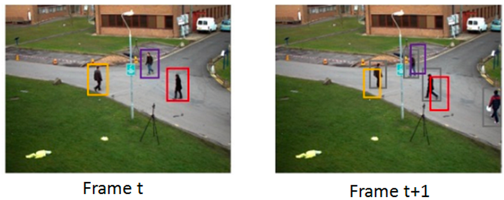
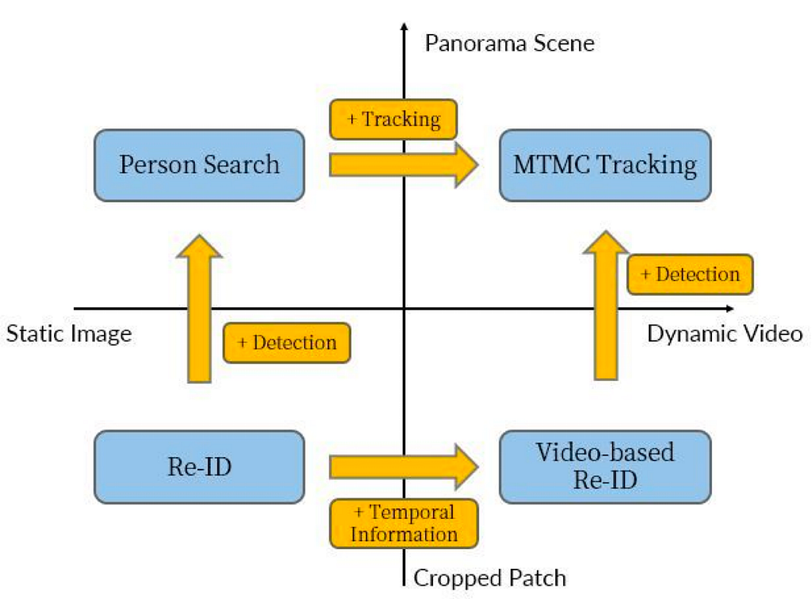
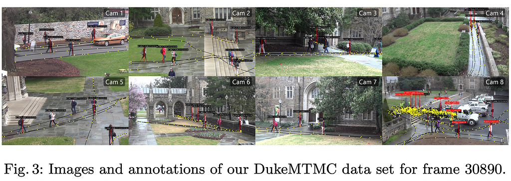
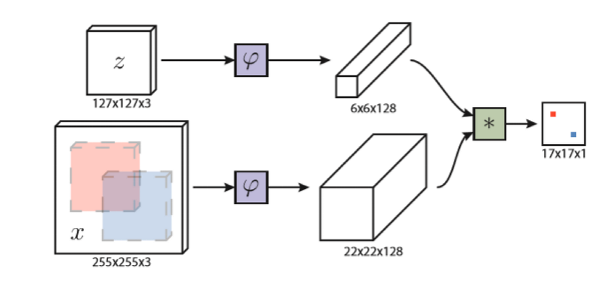

物件跟蹤／追蹤是什麼？

## 前言

電腦視覺（Computer Vision）在現今已經是非常重要的專業領域，無論是在軍事、無人駕駛、日常生活中都有所連繫。目前科技的進展在AI和深度學習上已經達到前所未有的強大能力，…

物件分類 -> 物件偵測 -> ？

### 物件偵測（Object Detection）

> 是模仿人類視覺對畫面中目標的判斷能力

## 追蹤(Tracking)在做什麼？

> 模仿人類視覺對運動物體的感知能力衍伸出的專業領域，對攝影機畫面的圖像序列進行解析。

## 追蹤的分類

- 依照作法可分為兩個類別：Re-ID、Object Tracking
- 依照目標可分為兩個類別：Visual Object Tracking (VOT, 又稱SOT)、Multiple Object Tracking (MOT)
- 終極目標：MTMOT （多目標多物件追蹤）

> 大多以**行人的移動**作為檢測目標

## Re-ID

重識別、跨鏡頭追蹤

根據目標的表觀特徵、姿態動作追蹤該目標

挑戰：數據因素、環境因素

應用領域：監視系統-天網系統

代表模型：CTL Model (ResNet50, 256x128)

資料庫: DukeMTMC、Market-1501

*DukeMTMC*

## VOT

*SiamFC*

- 又稱Single Object Tracking (SOT)
- 單純對單一畫面的同一目標追蹤
- 挑戰：複雜的外觀、移動模式、環境變化（光照、遮擋等）
- 代表模型：SiamFC、SiamRPN
- 資料庫：VOT Challenge

## Multi-Object Tracking

對單一畫格中的複數目標進行追蹤

挑戰：頻繁遮擋、軌跡初始及結束、相似外觀、目標相互影響

資料庫：MOT Challenge、AI CITY CHALLENGE

代表模型：Deep SORT、Tracktor、FairMOT

## MTMOT

終極目標

## Reference

- [云从科技资深算法研究员：详解跨镜追踪(ReID)技术实现及难点](https://zhuanlan.zhihu.com/p/38603624)
- [基于深度学习的视觉目标跟踪方法介绍](https://zhuanlan.zhihu.com/p/84183000)
- [SOT入门之Siam系列（一）：SiamFC](https://zhuanlan.zhihu.com/p/107428605)
- [mot数据集\_谈谈ReID与MOT的关系-CSDN博客](https://blog.csdn.net/weixin_42452580/article/details/112162074)
